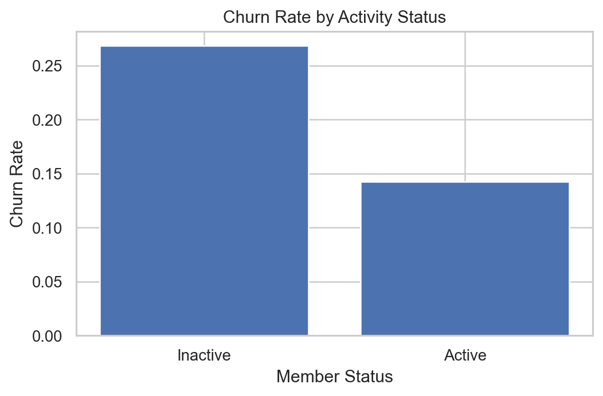
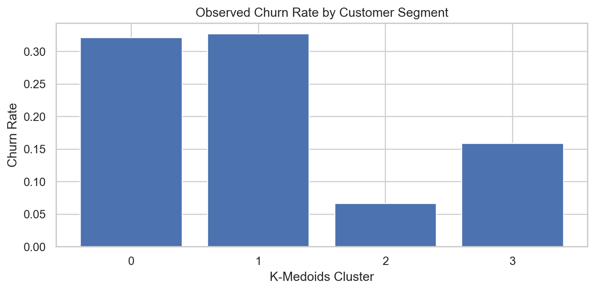
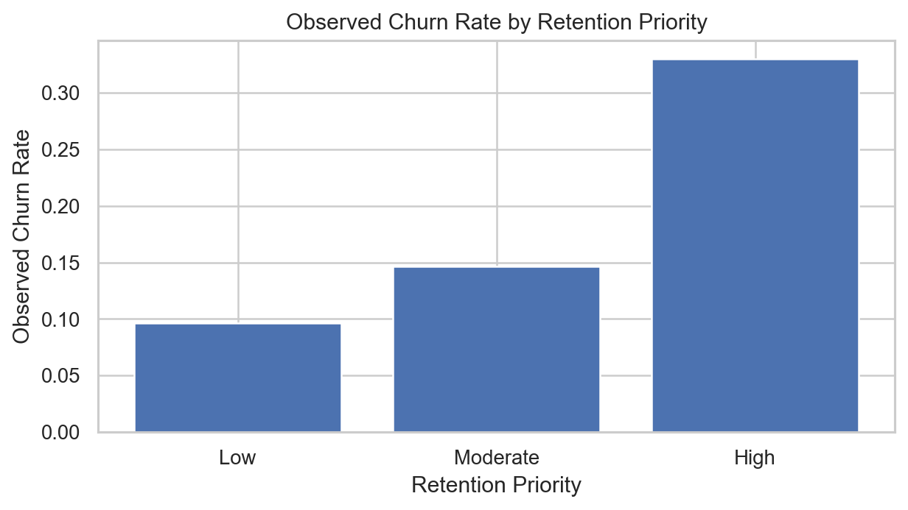
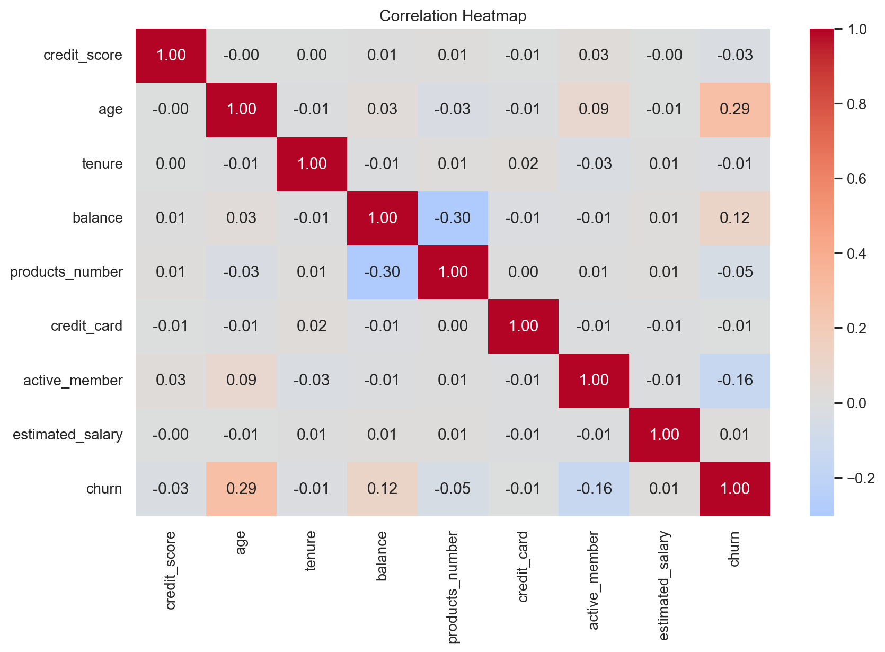

# Bank Customer Churn Segmentation & Retention Prioritization

An **individual Data Analytics / Data Mining portfolio project** that turns bank customer data into interpretable customer segments and an explainable retention-priority workflow.

The project goes beyond basic EDA by combining business KPIs, churn-aware feature selection, K-Medoids segmentation, hierarchical clustering benchmarking, and a transparent fuzzy decision system.

## Project Highlights

- 10,000 customer records analyzed end-to-end.
- Overall churn rate: **20.4%**.
- Inactive customers churn at **26.9%**, compared with **14.3%** for active customers.
- Germany has the highest observed country churn rate at **32.4%**.
- Genetic Algorithm selected: **age, tenure, balance, products_number, active_member, estimated_salary**.
- GA-selected subset achieved CV F1 of **0.584**, versus **0.563** using all source features on the fixed GA sample.
- K-Medoids produced **4 balanced business segments**.
- Highest-risk segment churn rate: **32.7%**.
- Lowest-risk segment churn rate: **6.7%**.
- Final fuzzy priority groups show observed churn rates of approximately **9.6% (Low)**, **14.6% (Moderate)**, and **33.0% (High)**.

## Business Objective

The goal is to help a bank answer two practical questions:

1. **What meaningful customer segments exist?**
2. **Which customers should receive more retention attention?**

The final system converts customer behavior and segment risk into an explainable priority score that can support retention teams.

> Important methodology note: the Genetic Algorithm uses churn as its fitness signal, so the clusters are intentionally **churn-informed business segments**, not purely unsupervised natural clusters.

## Workflow

1. Data quality audit
2. Exploratory Data Analysis
3. Business KPI analysis
4. Robust preprocessing
5. Genetic Algorithm for churn-aware feature selection
6. K-Medoids segmentation
7. Cluster profiling and business interpretation
8. Hierarchical clustering benchmark
9. Fuzzy retention-priority system
10. End-to-end scoring for new customers
11. Full customer priority export

## Key Visuals

### Churn Rate by Activity Status



### Churn Rate by Customer Segment



### Retention Priority vs Observed Churn



### Correlation Heatmap



## Main Customer Segments

| Cluster | Customers | Observed Churn | Interpretation |
|---:|---:|---:|---|
| 0 | 2,254 | 32.1% | High-risk, low-activity, higher-balance, low-product |
| 1 | 2,078 | 32.7% | High-risk, low-activity, higher-balance, multi-product |
| 2 | 2,897 | 6.7% | Low-risk, active, lower-balance, multi-product |
| 3 | 2,771 | 15.9% | Medium-risk, active, higher-balance, low-product |

## Business Recommendations

- Prioritize re-engagement campaigns for inactive customers.
- Use segment-specific retention offers rather than one campaign for everyone.
- Review the highest-risk segments before allocating expensive retention incentives.
- Use the fuzzy priority score as a transparent outreach queue, not as a replacement for business judgment.
- A/B test retention actions and measure incremental churn reduction because descriptive patterns are not causal proof.

## Methodology Improvements Built Into This Version

This portfolio version was deliberately strengthened for reproducibility and technical clarity:

- Uses **RobustScaler** rather than deleting legitimate extreme customers.
- Uses **one-hot encoding** for country instead of assigning arbitrary ordinal distances.
- Applies the **same fitted preprocessing** to new customer records.
- Seeds both Python and NumPy random generators for reproducible results.
- Clearly labels the GA as **supervised/churn-aware feature selection**.
- Implements K-Medoids without `scikit-learn-extra`, avoiding binary compatibility problems.
- Implements the fuzzy system without `scikit-fuzzy`, reducing installation friction.
- Rejects misleading hierarchical solutions that achieve high silhouette scores by isolating tiny outlier clusters.
- Uses a **relative cluster-risk index** so fuzzy risk memberships are calibrated to the discovered segments.
- Exports business-ready CSV tables and presentation-ready charts.

## Repository Structure

```text
bank-customer-churn-analysis/
|
|-- Bank_Customer_Churn_Analysis.ipynb
|-- bank_customer_churn.csv
|-- README.md
|-- requirements.txt
|-- .gitignore
|
|-- outputs/
|   |-- business_kpis.csv
|   |-- churn_by_country.csv
|   |-- churn_by_activity.csv
|   |-- churn_by_products.csv
|   |-- ga_feature_selection_summary.csv
|   |-- kmedoids_k_selection.csv
|   |-- hierarchical_clustering_comparison.csv
|   |-- clustering_model_comparison.csv
|   |-- cluster_profiles.csv
|   |-- retention_priority_summary.csv
|   |-- customer_retention_priorities.csv
|   |-- outlier_audit.csv
|   `-- charts/
|
`-- report/
    `-- Bank_Customer_Churn_Analysis_Report.pdf
```

## Technologies

- Python
- Pandas
- NumPy
- Matplotlib
- Seaborn
- scikit-learn
- SciPy
- Jupyter Notebook

## How to Run

Clone or download the repository, then install dependencies:

```bash
pip install -r requirements.txt
```

Open the notebook:

```bash
jupyter notebook Bank_Customer_Churn_Analysis.ipynb
```

Run the cells from top to bottom. The notebook creates the `outputs/` tables and charts automatically.

## Important Interpretation Note

The retention-priority system is an analytical decision-support example. It is not a production banking decision engine, credit-scoring model, or proof of causality. In a real deployment, retention actions should be validated with controlled experiments and monitored for fairness and business impact.

## Project Type

**Individual portfolio project - developed independently.**
